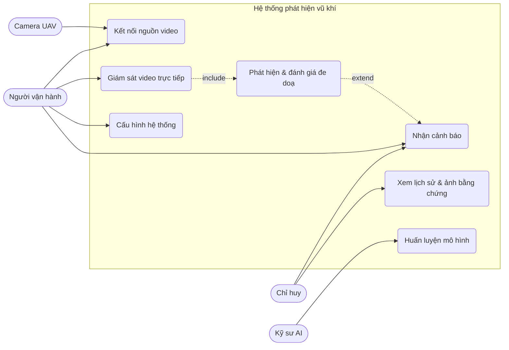
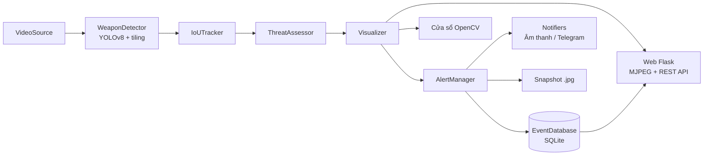
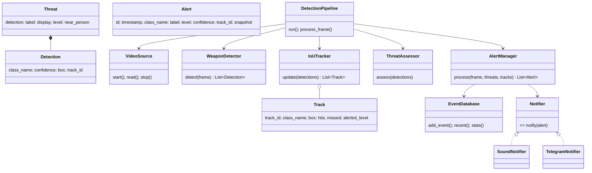
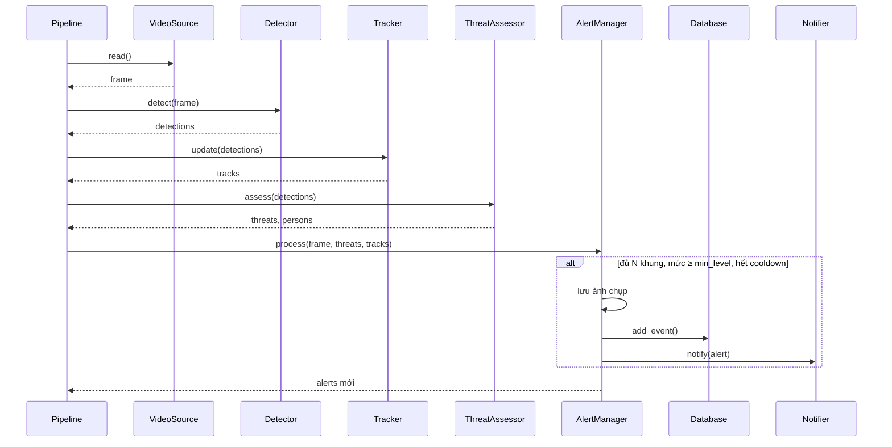

# Thiết kế hệ thống

## 1. Sơ đồ use case

## 2. Kiến trúc

Kiến trúc dạng **pipeline** (ống dẫn – bộ lọc), mỗi bước là một module độc lập:

| Module | Trách nhiệm |
|---|---|
| `video_source.py` | Mở nguồn video, luồng nền đọc khung mới nhất, tự kết nối lại |
| `detector.py` | Nạp YOLOv8, suy luận thường hoặc chia ô, gộp kết quả bằng NMS |
| `tracker.py` | Ghép detection với track cũ theo IoU, đếm số khung liên tiếp |
| `threat.py` | Ánh xạ lớp → mức đe doạ, tăng mức khi vũ khí gần người |
| `alert.py` | Lọc theo mức tối thiểu, số khung, cooldown; lưu ảnh, CSDL, gọi notifier |
| `notifier.py` | Phát âm thanh, gửi Telegram (chạy luồng riêng, không chặn) |
| `database.py` | Lưu/truy vấn sự kiện, thống kê |
| `visualizer.py` | Vẽ khung, nhãn, thanh trạng thái, viền cảnh báo |
| `web.py` | Dashboard, luồng MJPEG, API `/api/events`, `/api/stats` |
| `pipeline.py` | Điều phối toàn bộ các module |

### Mẫu thiết kế áp dụng
- **Pipeline / Pipes and Filters**: luồng xử lý tuần tự qua các bước.
- **Observer**: `AlertManager` thông báo tới danh sách `notifiers`.
- **Strategy**: `WeaponDetector` chọn chiến lược suy luận thường hoặc chia ô.
- **Producer–Consumer**: luồng đọc video và luồng xử lý trao đổi qua khung hình dùng chung có khoá.

## 3. Sơ đồ lớp

## 4. Sơ đồ tuần tự – xử lý một khung hình

## 5. Thiết kế dữ liệu

Bảng `events` (SQLite):

| Cột | Kiểu | Ý nghĩa |
|---|---|---|
| id | INTEGER PK | Mã sự kiện |
| timestamp | TEXT | Thời gian `YYYY-MM-DD HH:MM:SS` |
| class_name | TEXT | Lớp mô hình (knife, gun...) |
| label | TEXT | Tên tiếng Việt |
| level | TEXT | low / medium / high / critical |
| confidence | REAL | Độ tin cậy 0–1 |
| track_id | INTEGER | ID đối tượng |
| near_person | INTEGER | 1 nếu ở gần người |
| snapshot | TEXT | Đường dẫn ảnh |
| source | TEXT | Nguồn video |

## 6. Thuật toán chính

**Đánh giá đe doạ:** mức cơ sở lấy theo lớp trong `config.yaml`. Nếu khung vũ khí giao với khung người
được mở rộng thêm 30% → coi là "trong tay người", tăng 1 mức (ví dụ dao: cao → nghiêm trọng).

**Chống báo động giả:** một track chỉ được cảnh báo khi `hits ≥ min_consecutive_frames`; mỗi track chỉ
cảnh báo lại khi mức độ tăng; mỗi cặp (lớp, mức) có thời gian cooldown.

**Tiling:** ảnh được chia thành các ô 640×640 chồng lấn 20%, suy luận theo lô cùng ảnh toàn cảnh,
toạ độ được dịch về ảnh gốc rồi gộp bằng NMS theo từng lớp.
